<picture><source media="(prefers-color-scheme: dark)" srcset="assets/hero-dark.svg"></picture>

<picture><source media="(prefers-color-scheme: dark)" srcset="assets/stack-dark.svg"></picture>

<a href="https://github.com/Pavel107493/nvim"><picture><source media="(prefers-color-scheme: dark)" srcset="assets/project-nvim-dark.svg"></picture></a>&nbsp;<a href="https://github.com/Pavel107493/dotfiles"><picture><source media="(prefers-color-scheme: dark)" srcset="assets/project-dotfiles-dark.svg"></picture></a>

<a href="https://github.com/Pavel107493/PSL_bot_telegram"><picture><source media="(prefers-color-scheme: dark)" srcset="assets/project-psl-bot-telegram-dark.svg"></picture></a>&nbsp;<a href="https://github.com/Pavel107493/v2ray-gtk-client-zaraza"><picture><source media="(prefers-color-scheme: dark)" srcset="assets/project-v2ray-gtk-client-zaraza-dark.svg"></picture></a>

<picture><source media="(prefers-color-scheme: dark)" srcset="assets/wave-dark.svg"></picture>

<a href="https://github.com/Pavel107493?tab=repositories"><picture><source media="(prefers-color-scheme: dark)" srcset="assets/button-1-dark.svg"></picture></a>

<a href="https://metawka.github.io/expressive-profile/?from=Pavel107493"><picture><source media="(prefers-color-scheme: dark)" srcset="assets/credit-dark.svg"></picture></a>

